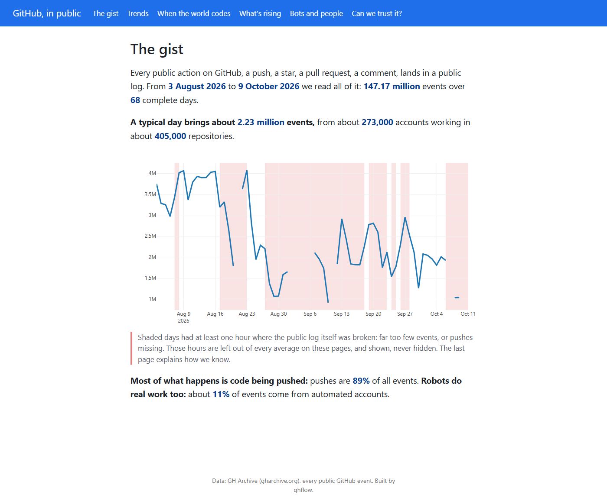
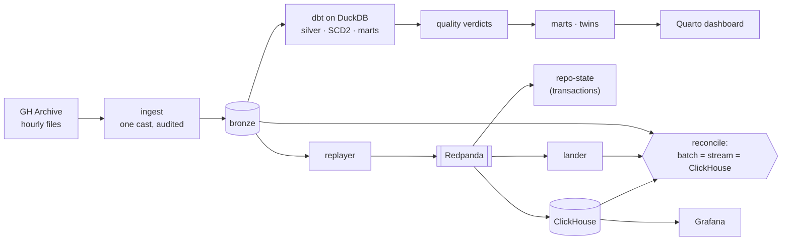
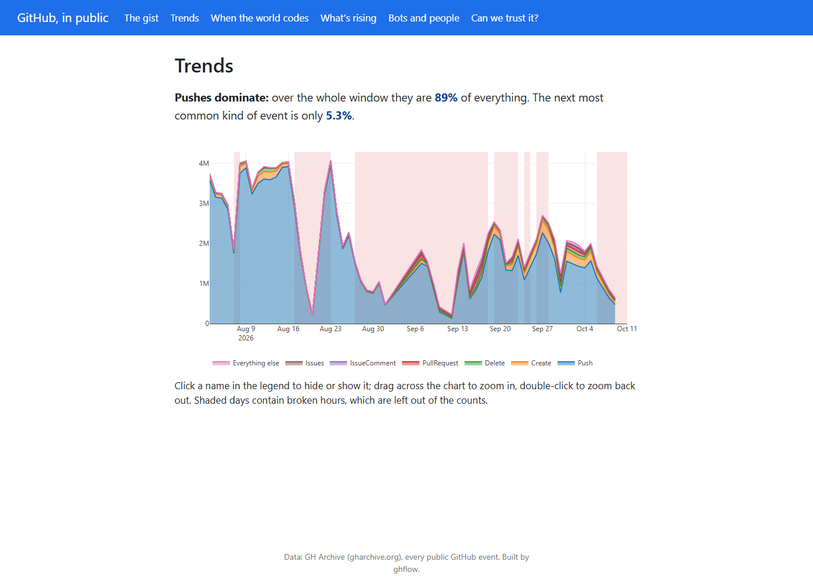
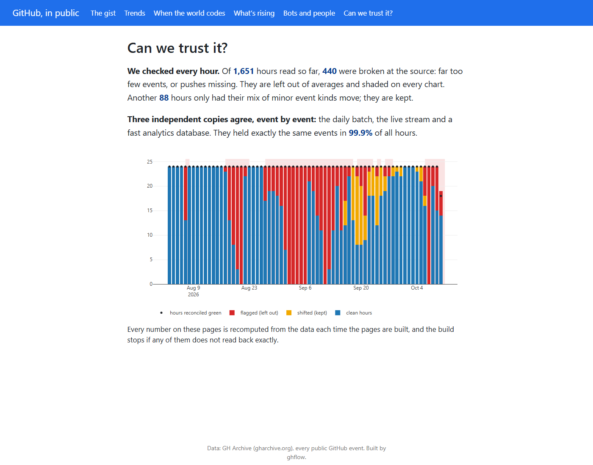
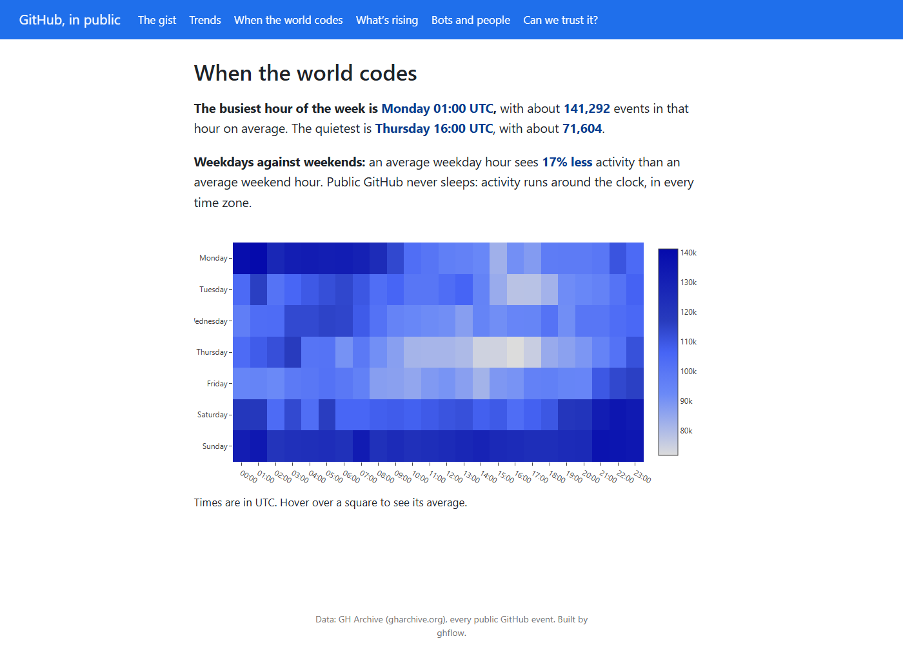
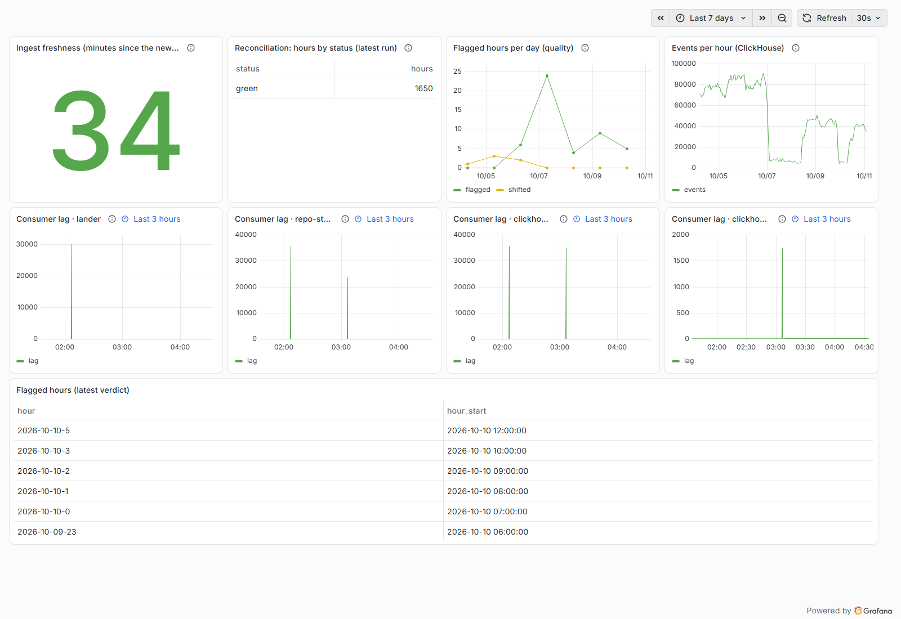

# ghflow

How does a pipeline know what is new when a dataset keeps changing? ghflow answers that on
[GH Archive](https://www.gharchive.org/), every public GitHub event, one file per hour. Two paths
must agree to the event: a batch path and a replayed stream. ClickHouse is a third witness. The
result reaches non-technical readers as a dashboard where every number is checked against the data.



## Try it

From a clean clone, on Windows with Docker Desktop:

```powershell
.\make.ps1 demo
```

The demo runs in its own compose project, `ghflow-demo`, with its own volumes:
- it takes 5–9 August 2026 (four clean days including a weekend, and one day with broken
  hours) through the whole system;
- it renders the dashboard;
- `scripts/demo_acceptance.py` judges the result into `automation/runs/m5-s4/demo.json`.

When it finishes:
- the dashboard is at http://127.0.0.1:33001;
- Grafana is at http://127.0.0.1:33000;
- Airflow is at http://127.0.0.1:38082.

The full pipeline, from 3 August 2026 onward and hourly since, is `.\make.ps1 up`. Then the
runbook takes over: [docs/RUNBOOK.md](docs/RUNBOOK.md).

## How it works



The full blueprint, with every service and DAG: [docs/architecture.md](docs/architecture.md).
Decisions: [docs/adr/](docs/adr/). KPIs: [docs/KPIS.md](docs/KPIS.md). Traps found along the way:
[docs/gotchas.md](docs/gotchas.md).

| | |
|---|---|
|  |  |
|  |  |

## What it proves

- **Two paths agree to the event, and a third confirms it.** Every hour, batch, stream and
  ClickHouse hold exactly the same event ids. Batch and stream reconciled 1,644 of 1,644 hours
  (147.5M events each); with ClickHouse added, 1,649 hours agreed across all three.
- **Broken data is caught, and stays visible.** The archive itself had broken hours. They are
  judged against a rolling baseline, left out of every average, and shaded on every chart.
- **Every number a stakeholder reads is checked.** Each one is re-read from its mart before the
  page is published. Every KPI has an independent twin query.
- **Names change, and history is kept.** Repository and account renames are slowly changing
  dimensions (SCD2). They match a compacted Kafka topic written in transactions.

## How it got better

Every milestone ended with a Refine story. Each change was measured against a prediction committed
before the change, and kept only if it met that prediction. The table is rendered from the
records (`scripts/readme_table.py`; a test fails if it drifts).

<!-- how-it-got-better:start -->
| Story | What was measured | Before | After | Outcome | Record |
|---|---|---|---|---|---|
| M0-S5 | contract parse, one typical hour | 2.33 s | 1.83 s | reverted: 21% faster, predicted 28% | `automation/runs/m0-s5/bench-verdict.json` |
| M1-S5 | ingest one day (orjson parser) | 75.79 s | 69.26 s | reverted: missed its bar | `automation/runs/m1-s5/verdict-parser.json` |
| M2-S4 | ingest one day (timestamp cast) | 77.13 s | 70.00 s | kept | `automation/runs/m2-s4/verdict-contract.json` |
| M2-S4 | warehouse after a full refresh (compaction) | 26.8 GB | 13.3 GB | kept | `automation/runs/m2-s4/verdict-warehouse.json` |
| M3-S3 | SCD2 build (incremental) | 58.15 s | 32.83 s | reverted: 43.5% saved, predicted 50% | `automation/runs/m3-s3/scd2.json` |
| M3-S3 | repo-state restart (persisted store) | 219 s | 5.01 s | kept | `automation/runs/m3-s3/restore.json` |
| M3-S3 | lander, one hour (no per-row copy) | 5.97 s | 4.80 s | kept | `automation/runs/m3-s3/verdict-l1.json` |
| M4-S3 | Grafana events-per-hour panel | 51.77 ms | 3.85 ms | kept | `automation/runs/m4-s3/panel.json` |
| M4-S3 | repo-state restart (short timeout) | 5.02 s | 1.52 s | reverted: 1.52 s, predicted 1.0 s | `automation/runs/m4-s3/restore-tail.json` |
| M5-S3 | a day's last hour to the dashboard, judged | 26.5 h | 30 min | kept | `automation/runs/m5-s3/latency.json` |
| M5-S3 | dashboard render | 11.57 s | 3.64 s | kept | `automation/runs/m5-s3/dashboard.json` |
| M5-S3 | dashboard bundle (zip) | 14.5 MB | 1.8 MB | kept | `automation/runs/m5-s3/dashboard.json` |
| M5-S3 | repo-state restart (skip when caught up) | 5.01 s | 0.01 s | kept | `automation/runs/m5-s3/restore-tail.json` |
<!-- how-it-got-better:end -->

## Built with

Airflow 3.3 · SeaweedFS (S3) · DuckDB + dbt · Redpanda + Schema Registry (Avro) · ClickHouse 26.3 ·
Grafana 13 · Quarto 1.10 · Python 3.12 (uv). The plan, layout and every story:
[docs/MILESTONES.md](docs/MILESTONES.md). How the work iterates:
[docs/ITERATION.md](docs/ITERATION.md).
