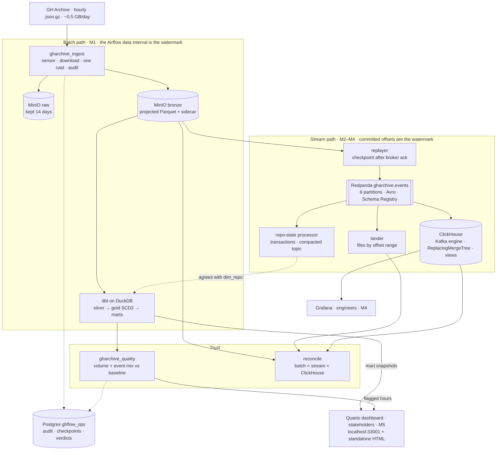

# Architecture

The blueprint of ghflow. GitHub renders the diagram below; the drawn version is
[img/architecture.svg](img/architecture.svg). This file is refreshed at every milestone close,
and from M5-S3 a checker fails if any compose service or DAG is missing from it.

## The system

Two boundaries the diagram encodes on purpose:
- **Airflow schedules the batch work; long-running services carry the stream.** Airflow runs the
  DAG-named boxes, plus `raw_retention`, `dbt_build`, `stream_compact` and `dashboard_render`. The
  replayer, lander and repo-state processor are services, never tasks that loop forever inside
  Airflow.
- **The stream starts from bronze, not from raw.** Parsing happens once, so any difference the
  reconciliation finds can only come from the stream transport.

## How each part knows what's new

| Part | Mechanism | Story |
|---|---|---|
| Batch ingest | The Airflow data interval is the hour; no stored watermark | M1-S1 |
| Upstream re-publication | ETag compared with the audit row | M1-S4 |
| Replayer | Its own checkpoint, moved only after the broker acks | M2-S1 |
| Lander | Committed consumer offsets, after the file is written | M2-S2 |
| Hour completeness | End-of-hour markers passed on every partition | M2-S2 |
| Repo state | Transactional offsets plus a compacted changelog | M3-S2 |
| ClickHouse | Kafka-engine offsets; materialized views see only new inserts | M4-S1 |
| Updates | SCD2 in dbt; ReplacingMergeTree keeps the latest version | M3-S1, M4-S1 |
| Stakeholder dashboard | Rebuilt after each daily build; refuses marts older than that build | M5-S2 |

## Where each piece lands

| Milestone | What becomes real | Release |
|---|---|---|
| M0 | Repo, plan, CI guards; source profile; event contract; MinIO, Postgres, Airflow | v0.0.0 |
| M1 | Hourly ingest, backfill from Aug 3, silver, event-mix quality checks | v0.1.0 |
| M2 | Redpanda + Schema Registry, replayer, lander, batch-vs-stream reconciliation | v0.2.0 |
| M3 | SCD2 repo/actor history; transactional compacted repo-state topic | v0.3.0 |
| M4 | ClickHouse consuming the topic; Grafana for engineers | v0.4.0 |
| M5 | Insight marts, the Quarto stakeholder dashboard, one-command demo | v1.0.0 |

Status at this revision (M0-S1): nothing runs yet; every box above is planned.
