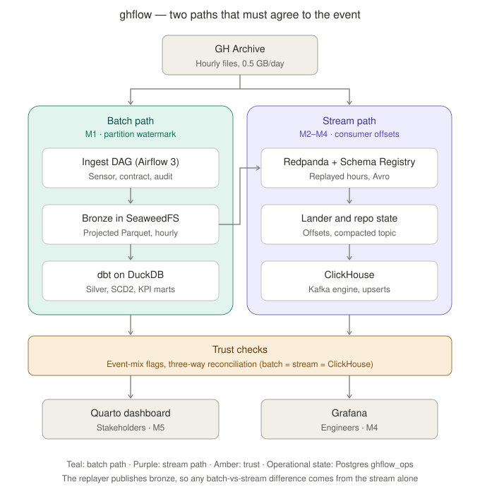
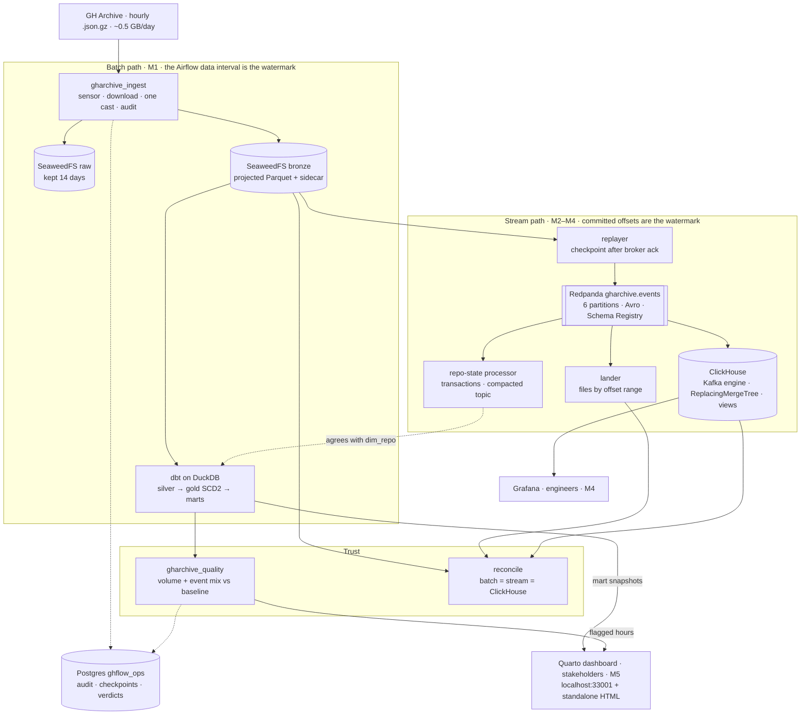
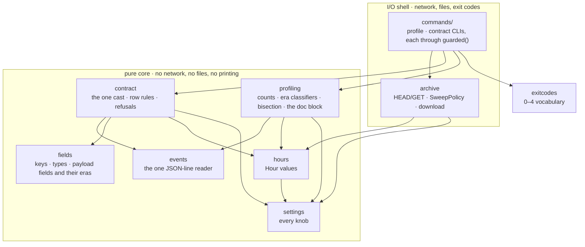
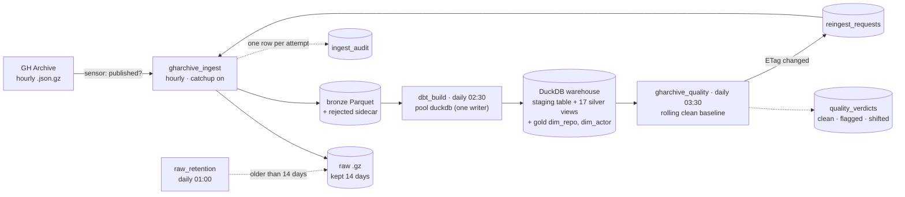
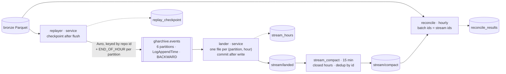
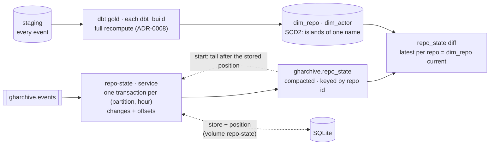
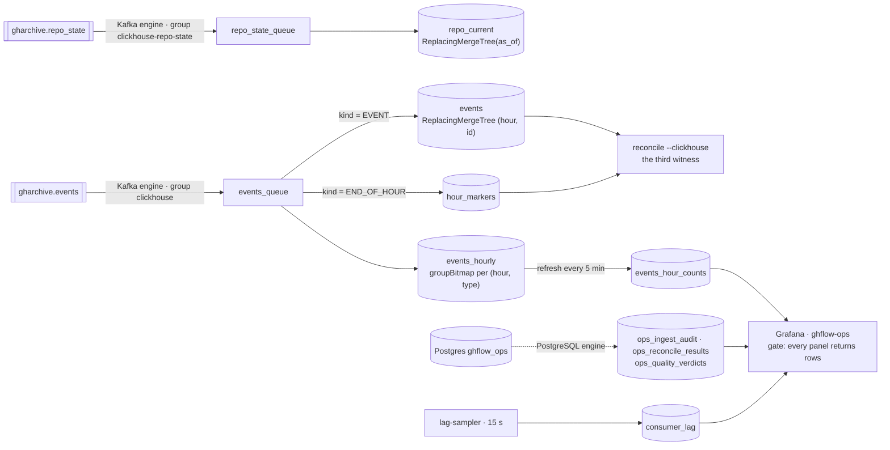

# Architecture

The blueprint of ghflow. GitHub renders the diagram below; the drawn version is
[img/architecture.svg](img/architecture.svg). Both are refreshed in every Refine story, and from
M5-S4 a checker fails if any compose service or DAG is missing from them.

## The system

Two boundaries the diagram encodes on purpose:
- **Airflow schedules the batch work; long-running services carry the stream.** Airflow runs the
  DAG-named boxes, plus `raw_retention`, `dbt_build`, `stream_compact` and `dashboard_render`. The
  replayer, lander and repo-state processor are services, never tasks that loop forever inside
  Airflow.
- **The stream starts from bronze, not from raw.** Parsing happens once, so any difference the
  reconciliation finds can only come from the stream transport.

## How each part knows what's new

| Part | Mechanism | Story |
|---|---|---|
| Batch ingest | The Airflow data interval is the hour; no stored watermark | M1-S1 |
| Upstream re-publication | ETag compared with the audit row | M1-S4 |
| Replayer | Its own checkpoint, moved only after the broker acks | M2-S1 |
| Lander | Committed consumer offsets, after the file is written | M2-S2 |
| Hour completeness | End-of-hour markers passed on every partition | M2-S2 |
| Repo state | Transactional offsets plus a compacted changelog | M3-S2 |
| ClickHouse | Kafka-engine offsets; materialized views see only new inserts | M4-S1 |
| Updates | SCD2 in dbt; ReplacingMergeTree keeps the latest version | M3-S1, M4-S1 |
| Stakeholder dashboard | Rebuilt after each daily build; refuses marts older than that build | M5-S2 |

## Where each piece lands

| Milestone | Build stories make real | Refine story improves | Release |
|---|---|---|---|
| M0 | Repo, plan and CI guards; source profile; event contract; SeaweedFS, Postgres, Airflow | one event reader, the readability/cohesion ratchet, the first benchmark | v0.0.0 |
| M1 | Hourly ingest, backfill from Aug 3, silver, event-mix quality checks | ingest throughput, thin DAGs — same bronze bytes | v0.1.0 |
| M2 | Redpanda + Schema Registry, replayer, lander, batch-vs-stream reconciliation | stream throughput, one client configuration | v0.2.0 |
| M3 | SCD2 repo/actor history; transactional compacted repo-state topic | cheaper history, faster restore | v0.3.0 |
| M4 | ClickHouse consuming the topic; Grafana for engineers | table design, panel latency | v0.4.0 |
| M5 | Insight marts, the Quarto stakeholder dashboard, one-command demo | the whole system, end to end | v1.0.0 |

A later insight that changes an earlier design is handled by a Realign story inserted into the
plan (see `MILESTONES.md`), and this blueprint changes with it.

## Inside `src/ghflow`: a pure core and an I/O shell

Since M0-S5 the Python package has two layers. The arrows are the only imports allowed;
import-linter (CI job `import-layers`) and `tests/unit/test_laws.py` refuse any other.

The DAGs (M1 onward) belong to the shell: they call core functions and hold no parsing logic.

## The batch path as it runs (M1)

Every DAG is thin by law (`tests/unit/test_thin_dags.py`): it calls `python -m ghflow.commands.…`
in the project venv and maps exit codes; parsing, Parquet and SQL live in `src/ghflow`.

## The replayed stream as it runs (M2)

Every Kafka client is built by `ghflow.stream.clients` (a test refuses client settings anywhere
else).

## History and repo state as they run (M3)

Two witnesses of the same fact, built differently:
- **Batch:** `dim_repo` is a function of every staged event, recomputed in full, so arrival order
  cannot matter (proved by `history late-hour`).
- **Stream:** `gharchive.repo_state` is a log of net changes committed atomically with the
  offsets. Its store survives restarts with the changelog position it reflects; a start reads
  only the tail, and a missing or impossible store means a full rebuild.
- **`diff`** compares the two over the hours both have seen. It found 0 stale, missing or extra
  repos over 13.59M repos.

## ClickHouse and Grafana as they run (M4)

- **Every table tolerates a re-read block.** The Kafka engine delivers at least once, and ReplacingMergeTree, bitmap states and markers-as-data absorb the duplicates (ADR-0010).
- **Grafana reads only ClickHouse** (ADR-0011). The ops data comes through PostgreSQL-engine tables, and lag through the sampler.

Status at this revision (M4-S3, `v0.4.0`):
- **Batch path:** runs end to end over the whole window (Aug 3 onward, hourly since), with the SCD2 dimensions.
- **Replayed stream:** carries the same window. Batch = stream = ClickHouse for every hour (three witnesses), and the repo-state topic equals `dim_repo`.
- **Ops:** the Grafana dashboard shows freshness, lag per consumer group, reconciliation and flagged hours.
- **Still planned:** the stakeholder dashboard (M5).
